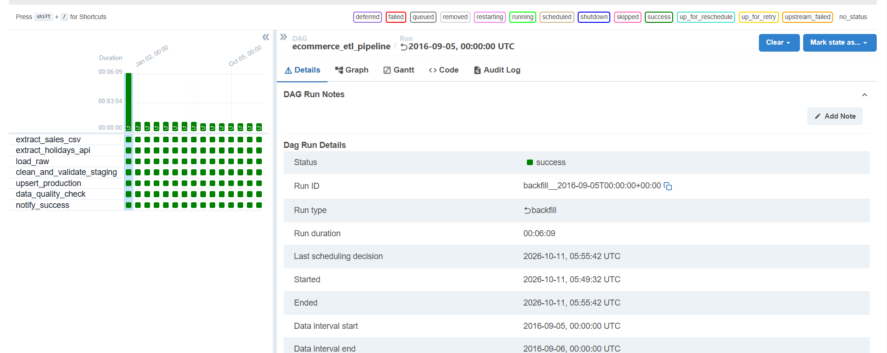
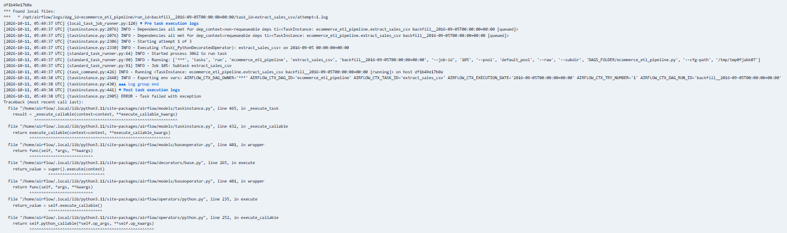
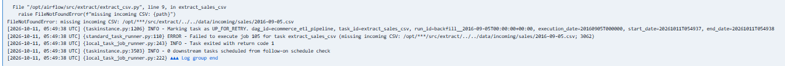
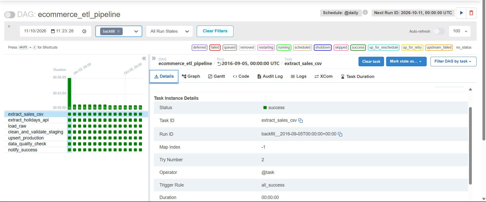
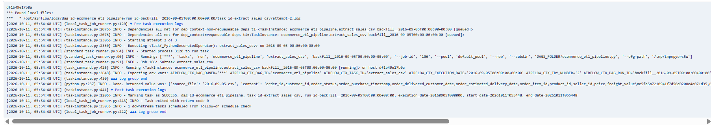

# Ecommerce ETL Pipeline — Project 2 of 3

A daily Apache Airflow pipeline that lands two **different source types** (bulk historical CSV files and a live public holiday API) into a layered PostgreSQL warehouse (raw → staging → production), with idempotent re-runs, a hard data-quality gate before success, and a deliberate logical-year guard so historical dates are replayed correctly.

Part of a three-repo portfolio:

| # | Repo | Scope |
|---|------|-------|
| 1 | [ecommerce-database-design](https://github.com/Ali-Ahmed-Farag/ecommerce-database-design) | PostgreSQL design + one-time historical seed for Olist (orders, items, payments, reviews, customers…) |
| 2 | **this repo** | Airflow ETL pipeline (CSV + API) that upserts into Project 1's `production` schema |
| 3 | [ecommerce-sales-dashboard](https://github.com/Ali-Ahmed-Farag/ecommerce-sales-dashboard) | Star schema, `fact_sales` materialized view, Power BI manual pack |

## Scope boundary (read this first)

This repository's DAG runs the full chain (9 tasks):

```
extract_sales_csv ─┐
                   ├─> load_raw ─> clean_and_validate_staging ─> upsert_production ─> load_dimension_tables ─> refresh_fact_materialized_view ─> data_quality_check ─> notify_success
extract_holidays_api ┘
```

Project 3's `analytics` schema (dimension tables + `fact_sales` materialized view, SQL lives in the `ecommerce-sales-dashboard` repo) is refreshed by the `load_dimension_tables` → `refresh_fact_materialized_view` tasks, and `data_quality_check` additionally runs the Project 3 checks (delivery-consistency, absolute `fact_sales`-vs-`production.order_items` row count, surrogate-key and date-key referential checks). The earlier truncation is superseded — see [`docs/decisions.md`](docs/decisions.md) (item 5, marked superseded).

The analytics SQL is mounted read-only into the Airflow container from `../ecommerce-sales-dashboard/sql`, so that repo must sit next to this one (path configurable via `ANALYTICS_SQL_DIR`). If the mount is missing, `load_dimension_tables` fails with `FileNotFoundError` and the downstream tasks never run (proven by test).

## Architecture

```text
             SOURCES                                LAYERS (PostgreSQL: ecommerce)
┌──────────────────────────────┐        ┌──────────────────────────────────────────────┐
│ data/incoming/sales/*.csv    │        │ raw.sales_daily      (load_date partition)   │
│  1,096 daily Olist files     │───┐    │ raw.holidays         (load_year partition)   │
│  (634 with data, 462 empty)  │   │    ├──────────────────────────────────────────────┤
└──────────────────────────────┘   │    │ staging.sales_cleaned (+ holiday flags)      │
┌──────────────────────────────┐   ├───>│ staging.holidays_validated                   │
│ BrasilAPI /feriados/v1/{year}│───┘    ├──────────────────────────────────────────────┤
│  national holidays, cached   │        │ production.orders / order_items / holidays   │
│  per logical year            │        │ (Project 1 tables, UPSERTed)                 │
└──────────────────────────────┘        └──────────────────────────────────────────────┘
                                                     ▲
                        Apache Airflow 2.9.3 (single container, LocalExecutor)
                        own metadata DB: airflow_metadata (never the business DB)
                        UI: http://localhost:8080
```

The DAG additionally refreshes Project 3's `analytics` schema after `upsert_production` (dimension upserts, then `REFRESH MATERIALIZED VIEW analytics.fact_sales`); see Scope boundary.

**Layering rationale:** `raw` is a faithful, immutable-per-partition landing copy (delete-then-insert per `load_date`) so a bad transform never loses source data; `staging` is recomputed from raw every run (cleaning, typing, dedup, holiday flags) so logic changes can be replayed; `production` receives only UPSERTs of already-validated rows keyed on Project 1's natural keys.

## Why holidays (and not currency) as the second source

A second source only earns its place if it **changes the meaning of the primary data**. Brazilian national holidays genuinely do: they explain delivery delays, order-purchase spikes and quiet days in an ecommerce dataset, and the flags land on every sales row (`is_national_holiday`, `is_holiday_week`) where an analyst can actually use them. Exchange rates, by contrast, are decorative for this dataset — every order is denominated in a single currency (BRL), so a FX series would attach to nothing and answer no question the data raises. Holidays are also **time-varying per historical year**, which forces (and demonstrates) the harder engineering problem: a guard keyed on the run's *logical* year rather than the wall clock, so replaying 2016 fetches 2016 holidays even though "today" is 2026.

## Tech stack

Python 3.11, pandas 2.2.2, requests, psycopg2, python-dotenv, Apache Airflow **2.9.3** (pinned, never `latest`), PostgreSQL 16 (Docker, host port 5433), Docker Compose, pytest.

## Repository layout

```text
ecommerce-etl-pipeline/
├── dags/ecommerce_etl_pipeline.py     # TaskFlow DAG: 9 tasks, retries=2 / 5 min
├── src/
│   ├── extract/   extract_csv.py, extract_holidays.py
│   ├── transform/ clean_and_merge.py
│   ├── load/      load_raw.py, load_staging.py, upsert_production.py, load_analytics.py
│   └── quality/   data_quality_checks.py   (Project 2 + Project 3 checks)
├── tests/         test_transform.py (26 unit tests) + test_analytics.py (11 unit tests)
├── sql/           create_schemas_and_tables.sql
├── scripts/       generate_incoming_csvs.py   (one-time CSV generation)
├── data/incoming/sales/                         (gitignored)
├── docs/decisions.md   # every deviation from the blueprint, with evidence
├── Dockerfile, docker-compose.yml, requirements.txt, .env.example
└── README.md
```

## How to run

```bash
# 1. generate the daily CSVs (one time, on the host)
python scripts/generate_incoming_csvs.py

# 2. apply the pipeline DDL (raw/staging/production.holidays)
Get-Content sql\create_schemas_and_tables.sql | docker exec -i ecommerce_postgres psql -U postgres -d ecommerce

# 3. build and start (UI on http://localhost:8080)
docker compose up -d --build

# 4. the DAG is created PAUSED on purpose. Replay history with a backfill window:
docker exec ecommerce_airflow airflow dags backfill -s 2017-01-01 -e 2017-01-07 ecommerce_etl_pipeline

# 5. single-day interactive run (does not unpause the DAG)
docker exec ecommerce_airflow airflow dags test ecommerce_etl_pipeline 2016-09-04

# 6. unit tests
docker exec ecommerce_airflow bash -c "cd /opt/airflow/tests && python -m pytest -q"
```

`catchup=False` and `is_paused_upon_creation=True` are set in the DAG. The DAG was unpaused manually once by the author while browsing the UI (not by itself, not by an unknown source); the scheduler then created one run for the most recent interval only (`scheduled__2026-10-10T00:00:00+00:00`, no rows loaded, deleted), and the DAG was re-paused. Business logic uses `{{ ds }}` / the run's logical date, never the wall clock.

## Data quality gate

`data_quality_check` runs **after** the fact refresh and before `notify_success` — if it fails, the run fails; no partial or silent success is possible.

- **Staging:** required-field nulls, allowed `order_status` values, `price > 0` on item rows, duplicate detection on `(order_id, order_item_seq, load_date)`, complete item fields.
- **Post-production:** staging-vs-production row counts (orders and items), referential checks (customer/product/seller must exist in Project 1's reference tables), and freshness.
- **Analytics (Project 3):** delivery-consistency (`order_delivered_date_key IS NULL` implies NULL delivery columns and NULL `is_late`), absolute `fact_sales` row count equals `production.order_items`, every surrogate key and every non-NULL date key in `fact_sales` exists in its dimension (purchase/estimated keys additionally never NULL).
- **Freshness distinguishes three cases** (this is a documented deviation, see [`docs/decisions.md`](docs/decisions.md) item 7):

| Incoming CSV for the logical date | raw rows | Result |
|---|---|---|
| missing entirely | — | **FAIL** `freshness_missing_incoming_file` (extract also raises `FileNotFoundError`) |
| present with data rows | 0 | **FAIL** `freshness_raw_missing` (the load is broken) |
| present but header-only (legitimate empty day) | 0 | **SUCCESS**, 0 rows end to end |

## Idempotency (what happens if you re-run a day)

| Layer | Mechanism | Re-run effect |
|---|---|---|
| raw | delete-then-insert per `load_date` | no duplicate partitions |
| staging | rebuilt from that day's raw partition every run | no accumulation |
| production | `INSERT … ON CONFLICT DO UPDATE` on natural keys | converges to the same end state |
| holidays | logical-year guard + unique index `(holiday_date, COALESCE(state,'__NATIONAL__'))` | no repeat API calls, no duplicate rows |
| dimensions | `INSERT … ON CONFLICT` on natural keys, key column never updated | same surrogate keys (checksums identical across reruns) |
| fact_sales | full `REFRESH MATERIALIZED VIEW` each run | recomputed end state (order-independent checksum identical) |

Verified: the 7-day window `2017-10-01…2017-10-07` was executed **twice**; all per-day staging checksums were byte-identical between runs, and `production` counts did not move.

## Verified end-to-end results

The figures up to the full backfill were executed with the 7-task DAG (before Project 3 integration); the 2017-01-01…2017-01-07 window was later re-executed with the 9-task DAG (7/7 runs, **63 of 63 tasks succeeded, 0 failed**, twice more including a `--reset-dagruns` re-run with identical per-layer checksums).

- Backfill `2017-10-01…2017-10-07`: 7/7 runs, **49/49 tasks succeeded, 0 failed** (twice — idempotency proof).
- Backfill `2017-01-01…2017-01-07` (4 empty days + 3 data days): 7/7 runs, **49/49 succeeded, 0 failed**; empty days land 0 rows, data days land 32/4/5 rows.
- Empty day `2016-01-01` via `dags test`: **7/7 tasks success, DagRun success** (quality gate passed with `errors: 0`).
- API path: first 2016 run fetched **13 national holidays** from BrasilAPI → `raw.holidays` (load_year 2016) → staging → `production.holidays`; 2017 was already cached, so those 7 runs returned `None` without calling the API.
- Protected Project 1 counts unchanged after every run: `orders 99441`, `order_items 112650`, `payments 103886`, `reviews 99224`; `production.holidays = 26` after those windows (2016 + 2017, both legitimately loaded; 39 after the full backfill below, with 2018 added).
- The DAG's metadata lives in a **separate** database (`airflow_metadata` container), never in the business database. That metadata database uses the default `airflow`/`airflow` credentials, which are local-dev only.
- Full backfill `2016-01-01…2018-12-31` (`airflow dags backfill -s 2016-01-01 -e 2018-12-31 ecommerce_etl_pipeline`): **1096 of 1096 runs success, 7672 tasks succeeded, 0 failed**, wall-clock 1 h 19 min 10 s; raw and staging hold **113,425 rows each**; `production.holidays = 39` (13 per year 2016–2018, `state` NULL on all 39); protected counts unchanged (`orders 99441`, `order_items 112650`, `payments 103886`, `reviews 99224`); DAG stayed paused; pre-existing successful runs were reused, no duplicates (1,096 runs / 1,096 distinct dates).
- Run history (`dag_run` table): 1,096 rows for 1,096 distinct dates, all `success` — 1,094 with run_type `backfill` and 2 with run_type `manual`; by run_id prefix 1,091 `backfill__` + 5 `manual__` (manual runs come from `dags test`, which deletes any same-date run first; `--reset-dagruns` backfills adopt same-date manual runs instead of duplicating them). The forced-failure evidence run `backfill__2016-09-05T00:00:00+00:00` is intact with `extract_sales_csv` at `try_number` 2.

## Deliberate failure demonstration (blueprint §13)

Proven inside a **real DagRun** (not `dags test`, which never advances retries). The DAG stays paused; the run was executed as a single-day backfill window.

- **Run:** `backfill__2016-09-05T00:00:00+00:00`, day `2016-09-05` (a day with data), command `airflow dags backfill -s 2016-09-05 -e 2016-09-05 ecommerce_etl_pipeline`.
- **What was forced:** the incoming file was renamed to `2016-09-05.csv.bak` before the run, so the file for the logical date was missing.
- **Attempt 1** (05:49:37 UTC): `extract_sales_csv` raised `FileNotFoundError: missing incoming CSV: …/data/incoming/sales/2016-09-05.csv`; Airflow marked the task `UP_FOR_RETRY` at 05:49:38 and recorded the failure in `task_fail`. The parallel `extract_holidays_api` task succeeded; all downstream tasks waited.
- **Recovery:** the CSV was restored during the 5-minute retry window (file re-verified: header + 1 data row, 2 lines).
- **Attempt 2** (05:54:48 UTC, exactly one `retry_delay` after attempt 1): `extract_sales_csv` succeeded and read `2016-09-05.csv`.
- **Final state:** `load_raw` → `clean_and_validate_staging` → `upsert_production` → `data_quality_check` → `notify_success` all succeeded at attempt 1; **DagRun state `success`**, 7/7 tasks succeeded, run duration 369.86 s, final `try_number` of `extract_sales_csv` = **2**.
- **No side effects:** Project 1 protected counts unchanged after the run — orders 99441, order_items 112650, payments 103886, reviews 99224 (the day's single order already existed; raw/staging each hold 1 row for `2016-09-05`).

The raw attempt logs live in the local `logs/` folder (gitignored, not pushed): `logs/dag_id=ecommerce_etl_pipeline/run_id=backfill__2016-09-05…/task_id=extract_sales_csv/attempt=1.log` and `attempt=2.log`. The screenshots in `docs/screenshots/` below are the published evidence of this run.


*Grid view: run `backfill__2016-09-05T00:00:00+00:00` ended `success` at 05:55:42 UTC with all 7 tasks green (run duration 00:06:09).*


*Attempt 1 log of `extract_sales_csv`: `Starting attempt 1 of 3` at 05:49:37 UTC while `2016-09-05.csv` was renamed away, followed by the task failing with an exception.*


*Attempt 1 log (tail): `FileNotFoundError: missing incoming CSV` followed by `Marking task as UP_FOR_RETRY` at 05:49:38 UTC.*


*Task Instance Details for `extract_sales_csv` in the same run: status `success` with `Try Number 2`, proving the retry recovered.*


*Attempt 2 log: the task restarted at 05:54:48 UTC after the CSV was restored, read `2016-09-05.csv`, and was marked `SUCCESS`.*

## Decisions and deviations

Every deviation from the blueprint — staging row identity, nullable item columns, holiday source union, image tag, DAG truncation (item 5, now superseded by the 9-task DAG), the `ds`-vs-`data_interval_start` year bug, the empty-day rule, the analytics mount and tasks, the Project 3 quality checks, and the `dags test` / `--reset-dagruns` run-handling findings — is written down with its evidence in [`docs/decisions.md`](docs/decisions.md).
